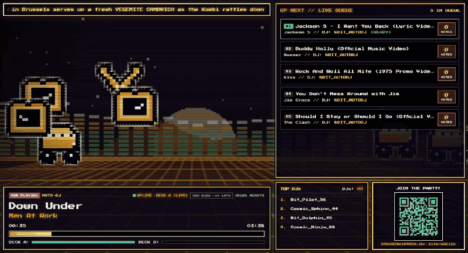
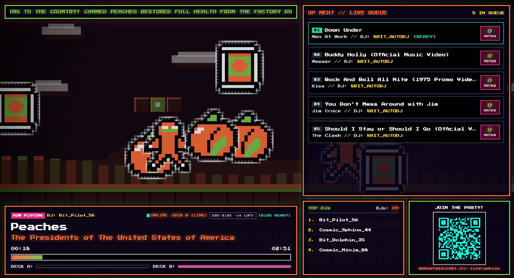
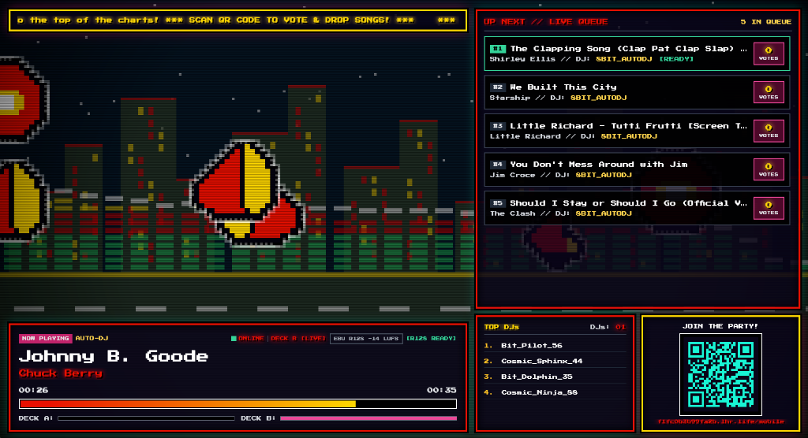
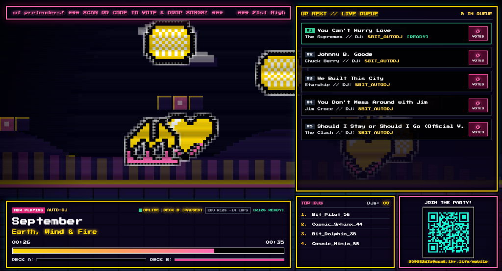
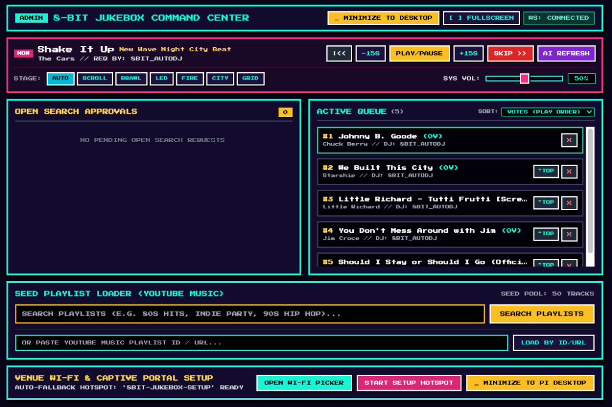
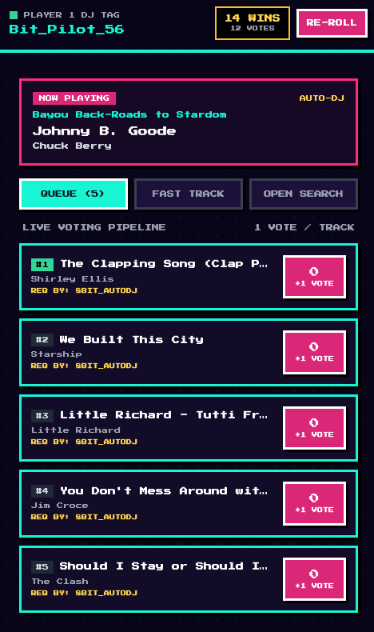

# 8-Bit Arcade Jukebox (`8bit-dj`)

Turn a **Raspberry Pi 5** (or any Mac / Linux machine) plugged into a TV or projector into an interactive **8-Bit Arcade Party Jukebox**.

Guests scan a QR code on the TV to join from their phones (over 5G/LTE or Wi-Fi—no app install required), get a random retro DJ tag, vote on the live queue, or request tracks from YouTube Music while the TV renders 60fps audio-reactive 8-bit stages and custom AI-generated pixel-art sprites.

[](./screenshots/demo.mp4)

## Screenshots

| Big Screen — Custom Gemini AI Pixel Art ("Peaches") | Big Screen — Midnight City Skyline Stage |
| :---: | :---: |
|  |  |

| Big Screen — Side-Scroller Platformer Stage | Host Admin Command Console (`/host`) | Mobile DJ Controller (`/mobile`) |
| :---: | :---: | :---: |
|  |  |  |

---

## Features

- **60fps Audio-Reactive 8-Bit TV HUD (`/bigscreen`)**:
  - **9 Built-In Retro Visualizer Stages**:
    - **90s Arcade Beat-'Em-Up (`BRAWL`)**: 2.5D belt-scroller street brawler stage (*Streets of Rage* / *Final Fight* style) with sparring pixel fighters, hit sparks, 1P vs BOSS health bars, and audio-reactive trash-barrel flames.
    - **Side-Scroller Platformer (`SCROLL`)**: Parallax clouds, hills, bouncing retro question blocks, and running/jumping pixel characters.
    - **Arcade Space Shooter (`SHMUP`)**: *Galaga* / *Gradius* warp starfield, ringed pixel planet, biomechanical tech trench, power-up capsule meter, and a hero ship with *Option* drones firing twin lasers into enemy formations.
    - **16-Bit JRPG Boss Battle (`JRPG`)**: *Final Fantasy* / *EarthBound* psychedelic battle wave backdrop, bevelled blue command menu (`FIGHT / MAGIC / ITEM`) with party HP/MP bars, a `3x`-scaled giant Boss sprite, and `999` damage popups.
    - **Gothic Castle Keep (`CASTLE`)**: *Castlevania* / *Bowser's Castle* stone archways, blood moon, flickering audio-reactive wall torches, stone battlements, and a bubbling lava moat.
    - **Classic Winamp LED Analyzer (`LED`)**: Segmented green/amber/red LED spectrum analyzer with gravity peak-hold caps and live oscilloscope ribbon.
    - **Winamp Demoscene Fire (`FIRE`)**: Audio-reactive rising embers, dual sine plasma waves, and mirrored spectrum bars.
    - **Midnight City Cruiser (`CITY`)**: Parallax skyscrapers with audio-reactive lit windows and scrolling night highway.
    - **80s OutRun Synth Grid (`GRID`)**: Segmented synthwave sun, pixel mountain silhouette, and perspective cyber grid.
  - **Gemini AI 8-Bit Scene & Sprite Generator (with Zero-Key Fallback)**:
    - Uses **Gemini 2.5 Flash** (`google-genai`) to generate song-specific stage titles, RPG battle flavor text, 4-color neon palettes, and custom 16x16 pixel-art sprites tailored to each track's genre and lyrics.
    - Works **100% out of the box without an API key** using built-in deterministic retro chiptune scenes and sprites.
  - **Live Pending Approval Alert**: Flashes an alert banner on the main TV screen whenever a guest submits an Open Search track awaiting Host approval.

- **Dual-Deck Web Audio Engine & Prioritized EBU R128 Pre-fetcher**:
  - **6-Second Equal-Power Crossfader**: Seamlessly crossfades between `Deck A` and `Deck B` (via Web Audio API cosine/sine curves) 6 seconds before each track ends or when the Host triggers a skip.
  - **Prioritized Background Pre-fetcher**: Downloads audio via `yt-dlp` and pipes it through `ffmpeg` with silence trimming and EBU R128 loudness normalization (`loudnorm=I=-14:TP=-1.5:LRA=11`) into `/tmp/audio_cache/`, always prioritizing `Now Playing` and `#1 Up Next` first.
  - **Auto-DJ Seed Pool (YouTube Music & Spotify)**: Automatically keeps at least 5 tracks in the queue from your chosen **YouTube Music** or **Spotify** seed playlist so the party never hits dead air.
  - **Zero-Account Spotify Support**: Load any public **Spotify Playlist** (`open.spotify.com/playlist/...`) or **Spotify Track** (`open.spotify.com/track/...`)—or pick from 15+ built-in official Spotify playlists (*All Out 80s*, *All Out 90s*, *Rock Classics*, *Disco Forever*, etc.)—with **no Spotify account or API key required**.

- **Pocket Arcade Mobile DJ Controller (`/mobile`)**:
  - **Automatic Public HTTPS Tunnel**: Spawns a free outbound SSH reverse tunnel (`localhost.run`) on startup and updates the TV QR code automatically—guests can scan and join over mobile data (5G/LTE) even if they aren't on the venue's Wi-Fi.
  - **Two Request Modes**:
    - **Fast Track**: Instant queueing from the Host's pre-approved Seed Playlist pool.
    - **Open Search**: Full YouTube Music search (`ytmusicapi`) or Spotify track link paste routed to the Host Approval queue.
  - **Live Voting & DJ Leaderboard**: 1 vote per guest per track, automatic queue re-ordering, and a live Top DJs leaderboard.

- **Host Admin Command Console (`/host` & TV Popup)**:
  - **PIN-Free on Device, PIN-Protected Remotely**: Click the QR code box (or press `H`) on the TV to open the Host Console popup immediately with no PIN required on the local device; remote access over LAN or the public tunnel is protected by `HOST_PIN`.
  - **System-Level Master Volume Slider (`0%–100%`, default `50%`)**: Controls OS PipeWire / WirePlumber HDMI audio volume (`wpctl`) on the Pi (or `osascript` on macOS).
  - **YouTube Music Playlist Search & Loader**: Search for any party/genre playlist (e.g. `"80s Party"`, `"90s Hip Hop"`, `"Indie Dance"`) and load it into the Seed Pool with 1 click.
  - **1-Click Minimize to Desktop**: Includes a `[ _ MINIMIZE TO DESKTOP ]` button (and `F11` keyboard support) to minimize the full-screen TV HUD to the Raspberry Pi taskbar anytime.

- **Hotel-Style Captive Portal Wi-Fi Setup (`8BIT-JUKEBOX-SETUP`)**:
  - Take your Pi to a new venue with unknown Wi-Fi: if the Pi has no internet connection for 25 seconds on boot, it automatically broadcasts an open Wi-Fi hotspot (`8BIT-JUKEBOX-SETUP`) and switches the TV QR code to a Wi-Fi join QR.
  - Scanning the QR code on your phone automatically pops up the **8-Bit Captive Portal Wi-Fi Picker** (`http://10.42.0.1:8000/wifi-setup`) so you can select the venue's Wi-Fi and enter the password right from your phone.

---

## Quick Start on Raspberry Pi 5 (Raspberry Pi OS Bookworm / Trixie 64-bit)

### 1. Clone the Repository on Your Raspberry Pi
```bash
git clone https://github.com/glen-foster/8bit-dj.git ~/8bit-dj
cd ~/8bit-dj
```

### 2. Run the Automated Installer (`setup_pi.sh`)
```bash
chmod +x setup_pi.sh
./setup_pi.sh
```
What `./setup_pi.sh` does automatically:
1. Installs system packages (`ffmpeg`, `mpv`, `nodejs`, `chromium`, `python3-venv`, `sqlite3`, `wlrctl`, `wtype`, `iptables`, `dnsmasq-base`).
2. Creates `./venv` and installs all Python dependencies from `requirements.txt`.
3. Creates `.env` from `.env.example` (if not already present).
4. Configures and starts the `systemd` background service (`jukebox-backend.service`).
5. Configures desktop autologin and launches Chromium in borderless full-screen mode (`launch_kiosk.sh`) pointing to `http://localhost:8000/bigscreen` at 50% default system volume.

### 3. Configure Your `.env` (Recommended)
Edit `~/8bit-dj/.env` to set your own `HOST_PIN` (for remote admin access) and optional `GEMINI_API_KEY`:
```bash
nano ~/8bit-dj/.env
```
```ini
# Change this before hosting a party! Used when accessing /host remotely
HOST_PIN=1234

# Optional: Google Gemini API Key for AI-generated custom 16x16 pixel sprites
# Get a free key at https://aistudio.google.com/ (falls back to built-in 8-bit scenes if omitted)
GEMINI_API_KEY=your_gemini_api_key_here
```
Then restart the backend service (or reboot into full-screen mode):
```bash
sudo systemctl restart jukebox-backend.service
# Or reboot to test full-screen TV auto-start:
sudo reboot
```

---

## Running Locally on macOS or Linux

You can also run the entire Jukebox on a laptop connected to a TV or speakers:

```bash
git clone https://github.com/glen-foster/8bit-dj.git
cd 8bit-dj
python3 -m venv venv
./venv/bin/pip install -r requirements.txt
cp .env.example .env
./venv/bin/uvicorn main:app --host 0.0.0.0 --port 8000
```
*(Make sure `ffmpeg` and `node` are installed, e.g. `brew install ffmpeg node` on macOS).*

Then open:
- **Big Screen TV HUD**: `http://localhost:8000/bigscreen`
- **Mobile DJ Controller**: `http://localhost:8000/mobile` (or scan the QR code on the Big Screen)
- **Host Admin Console**: `http://localhost:8000/host` (or click the QR code box / press `H` on the Big Screen)

---

## Keyboard Shortcuts on the Big Screen (`/bigscreen`)

| Key / Action | Description |
| :--- | :--- |
| **`H`** or **Click QR Code Box** | Open / Close the Host Admin Console popup |
| **`V`** | Cycle through the 6 retro visualizer stages (`AUTO`, `SCROLL`, `BRAWL`, `LED`, `FIRE`, `CITY`, `GRID`) |
| **`F11`** | Toggle Full-Screen / Windowed mode (on Raspberry Pi / Desktop) |
| **`Esc`** | Close the Host Admin Console popup |

---

## Useful Commands on the Raspberry Pi

- **View live logs (and check the active public tunnel URL)**:
  ```bash
  sudo journalctl -u jukebox-backend.service -f
  ```
- **Restart the backend**:
  ```bash
  sudo systemctl restart jukebox-backend.service
  ```
- **Reset the database (clear queue history, votes, and leaderboard)**:
  ```bash
  sudo systemctl stop jukebox-backend.service
  rm -f ~/8bit-dj/jukebox.db*
  sudo systemctl start jukebox-backend.service
  ```

---

## License

Released under the [MIT License](./LICENSE).
